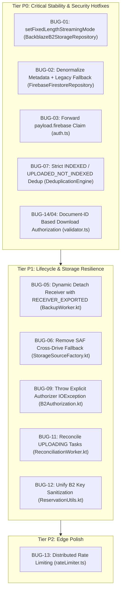

# USBCloudBackup — Remediation Implementation Plan

> **Specification State**: FINAL APPROVED SPECIFICATION — READY FOR IMPLEMENTATION REVIEW  
> **Target Systems**: `USBCloudBackup` (Android Ingestion Agent & Cloudflare Worker B2 Authorizer)  
> **Application ID**: `com.usbcloudbackup`  
> **Cloud Storage**: Backblaze B2 (`BrightCloud` bucket via S3-compatible API & Scoped SigV4 Presigned URLs)  
> **Zero Code Edits Applied Yet**: Awaiting explicit user approval before modifying code.

---

## 1. Goal Description

This implementation plan resolves the audited bugs in the `USBCloudBackup` repository across three priority tiers (**P0**, **P1**, and **P2**), while strictly preserving all existing system invariants:
- **Universal Automatic File Upload**: Every readable regular user file discovered on an attached USB device (`.mp4`, `.mp3`, `.zip`, `.apk`, `.iso`, unknown extensions, extensionless files) is automatically hashed, deduplicated, and streamed to Backblaze B2. (BUG-08 remains explicitly rejected).
- **Headless Android Daemon**: The Android app acts strictly as an upload engine with no permanent user-facing monitoring dashboard. (BUG-10 remains explicitly rejected).
- **Zero Root B2 Credentials in Android APK**: All cloud storage operations use short-lived SigV4 presigned URLs generated by the Cloudflare Worker authorizer.
- **Document-Specific Download Authorization**: Friend download authorization uses a direct Firestore document read for `vaults/{vaultId}/files/{fileId}`, deriving the B2 object key from the authorized document rather than accepting arbitrary client-supplied paths. `/settings/config` remains strictly Google-Admin only.
- **Legacy Record Safety**: Backward-compatible fallback logic ensures legacy `contentHashes` records lacking denormalized metadata do not fail or crash the ingestion pipeline.
- **Duplicate Qualification Safety**: A file may only cause another identical file to be `SKIPPED_DUPLICATE` if canonical bytes already exist in B2 (`INDEXED` or `UPLOADED_NOT_INDEXED`). `NAME_RESERVED` and `UPLOADING` are strictly excluded from qualifying duplicate statuses.
- **Robust Dynamic USB Detach Delivery**: Dynamically registered receiver for `ACTION_USB_DEVICE_DETACHED` uses `ContextCompat.RECEIVER_EXPORTED` to guarantee delivery of system broadcasts across Android API 24–36 without leaking receivers or racing cancellations.

---

## 2. Technical Clarifications & Invariants

> [!IMPORTANT]
> **BUG-07: Duplicate Qualification Safety Semantics**:
> - **Invariant**: A candidate file may only cause another identical file to be `SKIPPED_DUPLICATE` if:
>   1. Canonical bytes already exist in B2, OR
>   2. The referenced upload task is guaranteed to be recoverable and will produce canonical bytes.
> - **State Semantics Audit**:
>   - `NAME_RESERVED`: 0 bytes in B2. No recovery path exists in `ReconciliationWorker` (which runs without the USB drive and cannot upload bytes). If File A fails in `NAME_RESERVED` and File B skips itself, both files result in permanent zero-byte data loss. **Fails invariant → REMOVED**.
>   - `UPLOADING`: 0 to partial bytes in B2. If severed mid-stream, `ReconciliationWorker` cannot upload missing bytes without the physical USB stream. If File B skips itself against File A, File B is also permanently lost. **Fails invariant → REMOVED**.
>   - `UPLOADED_NOT_INDEXED`: 100% of bytes confirmed in B2. `ReconciliationWorker` can finalize Firestore metadata without USB stream. **Satisfies invariant → QUALIFIES**.
>   - `INDEXED`: 100% uploaded to B2 and committed to Firestore. **Satisfies invariant → QUALIFIES**.
> - **Qualifying Statuses**: Strictly `FileStatus.INDEXED` and `FileStatus.UPLOADED_NOT_INDEXED`.
> - **Intra-Batch Deduplication**: In `BackupWorker.kt` Step 7 (Uploading loop), a just-in-time check before uploading ensures that when multiple files in the same run share a hash, once File A completes upload, File B skips uploading redundant bytes. If File A crashes before upload, File B proceeds to upload. Exactly one file uploads bytes to B2, guaranteeing zero data loss.

> [!IMPORTANT]
> **BUG-05: Dynamic USB Detach Receiver Specification (API 24–36)**:
> - **Broadcast Action**: `UsbManager.ACTION_USB_DEVICE_DETACHED` (`android.hardware.usb.action.USB_DEVICE_DETACHED`). Emitted exclusively by the Android framework (`system_server` / `UsbDeviceManager`).
> - **API Flag Verification**: On Android 14+ (API 34+), dynamic receivers registered for non-internal broadcasts must specify an export flag. If registered with `RECEIVER_NOT_EXPORTED`, the platform restricts delivery to intra-app broadcasts, which on several OEM Android 14+ distributions causes system broadcasts to be dropped.
> - **Selected Flag**: `ContextCompat.RECEIVER_EXPORTED`.
> - **Security Audit**: `ACTION_USB_DEVICE_DETACHED` is declared with `<protected-broadcast android:name="android.hardware.usb.action.USB_DEVICE_DETACHED" />` in Android OS `framework-res`. Non-system apps are blocked by Android's `ActivityManagerService` from sending this intent (enforced with `SecurityException`). Thus, `RECEIVER_EXPORTED` carries ZERO vulnerability to third-party spoofing.
> - **Supported API Compatibility (24–36)**:
>   - API 24–32: `ContextCompat.registerReceiver` automatically ignores the flag and safely delegates to `context.registerReceiver(receiver, filter)`.
>   - API 33–36: `ContextCompat.registerReceiver` forwards `Context.RECEIVER_EXPORTED`, fulfilling Android 14+ mandatory export requirements and guaranteeing system broadcast delivery.
> - **Lifecycle Management**: Registered dynamically at the start of `BackupWorker.doWork()` and unregistered in `finally`. Preempts active coroutine immediately via `job.cancel(CancellationException(...))` and cancels WorkManager task via `BackupWorkManager.cancelBackup(context, sourceId)`. Persisted state remains fully recoverable.
> - **Manifest Architecture**: Manifest receiver `UsbEventReceiver` remains responsible solely for `ACTION_USB_DEVICE_ATTACHED` (hardware plug-in event to enqueue backup), preventing duplicate registration races.

> [!IMPORTANT]
> **API Contract Update for Download Authorization (BUG-14 / BUG-04)**:
> The web download authorization endpoint `/b2/download-authorize` changes its input contract from `{ objectKey: string }` to `{ fileId: string, vaultId?: string }`. The Cloudflare Authorizer reads `b2ObjectKey` directly from the authorized Firestore document (`vaults/{vaultId}/files/{fileId}`) using the caller's token. Clients can no longer supply arbitrary B2 object paths. `/vaults/{vaultId}/settings/config` remains strictly admin-accessible (`allow read, write: if isAdmin(vaultId);`).

---

## 3. Priority Tiers & Architecture Overview



---

## 4. Proposed Changes

---

### Component 1: Cloudflare Worker Authorizer (`backend/b2-authorizer/`)

#### [MODIFY] `backend/b2-authorizer/src/types.ts`
- Update `DownloadAuthorizeRequest` to accept `fileId` and optional `vaultId`:
```typescript
export interface DownloadAuthorizeRequest {
  fileId: string;
  vaultId?: string;
}

export interface DownloadAuthorizeResponse {
  downloadUrl: string;
  expiresAt: number;
  fileId: string;
  storedName?: string;
  headers?: Record<string, string>;
}
```
- Ensure `VerifiedToken` contains `firebase?: { sign_in_provider?: string; [key: string]: any }`.

#### [MODIFY] `backend/b2-authorizer/src/auth.ts`
- **Fix BUG-03**: Populate `firebase: payload.firebase` in `verifyFirebaseToken`:
```typescript
return {
  uid: payload.sub,
  email: payload.email,
  firebase: payload.firebase, // FIX BUG-03: Forward firebase claim
  authTime: payload.auth_time || 0,
  exp: payload.exp,
  iss: payload.iss,
  aud: payload.aud
};
```

#### [MODIFY] `backend/b2-authorizer/src/validator.ts`
- **Fix BUG-14 & BUG-04**: Redesign `validateDownloadRequest` and `isAuthorizedToDownload`:
  1. Validate `fileId` is a non-empty string, length <= 256, no path traversal or slashes.
  2. In `isAuthorizedToDownload`, immediately reject anonymous callers:
     ```typescript
     if (caller.firebase?.sign_in_provider === "anonymous") {
       return null; // Denied
     }
     ```
  3. Direct Document Read: Query Firestore REST API for the specific document:
     `https://firestore.googleapis.com/v1/projects/${projectId}/databases/(default)/documents/vaults/${vaultId}/files/${fileId}`
     Forwarding the caller's `Authorization: Bearer <token>`.
  4. If Firestore returns HTTP 200:
     Extract `b2ObjectKey` and `storedName` from the Firestore document fields.
     Validate `b2ObjectKey` belongs to `backups/${vaultId}/`.
     Return `{ authorized: true, b2ObjectKey, storedName }`.
  5. If Firestore returns 403 or 404:
     Return `null` (Access Denied).
  6. `/settings/config` is never queried by friends, preserving strict admin isolation.

#### [MODIFY] `backend/b2-authorizer/src/index.ts`
- Update `/b2/download-authorize` handler to use the new `fileId` flow and pass the derived `b2ObjectKey` to `generateDownloadAuthorization()`.

#### [MODIFY] `backend/b2-authorizer/test/run-all-tests.mjs`
- Update download authorization test suite:
  1. Admin + fileId → 200
  2. Friend + `isPublicToFriends=true` → 200
  3. Friend + `uid in allowedFriends` → 200
  4. Friend + private file + `uid not in allowedFriends` → 403
  5. Friend authorized for File A requesting private File B → 403
  6. Friend cannot supply arbitrary `b2ObjectKey` to bypass file authorization
  7. Anonymous daemon + any fileId → 403
  8. Cross-vault fileId mismatch → 403
  9. Missing fileId/document → 403
  10. Authorized file document contains the B2 key used to generate the presigned URL.

---

### Component 2: Backblaze B2 Streaming & Authorization Layer (`app/src/main/java/.../cloud/storage/`)

#### [MODIFY] `app/src/main/java/com/usbcloudbackup/cloud/storage/b2/BackblazeB2StorageRepository.kt`
- **Fix BUG-01**: Retrieve exact known file size and configure streaming mode on `HttpURLConnection`:
```kotlin
val contentLength = metadata["Content-Length"]?.toLongOrNull()
    ?: metadata["x-custom-file-size"]?.toLongOrNull()
    ?: 0L

val connection = (url.openConnection() as HttpURLConnection).apply {
    requestMethod = "PUT"
    doOutput = true
    if (contentLength > 0L) {
        setFixedLengthStreamingMode(contentLength)
    } else {
        setChunkedStreamingMode(BUFFER_SIZE)
    }
    connectTimeout = CONNECT_TIMEOUT_MS
    readTimeout = READ_TIMEOUT_MS
    ...
}
```

#### [MODIFY] `app/src/main/java/com/usbcloudbackup/cloud/storage/b2/B2Authorization.kt`
- **Fix BUG-09**: On non-2xx HTTP responses or network errors, throw an explicit `IOException("B2 authorization failed with HTTP $responseCode: $errorBody")`. Remove silent dummy fallback (`$backendBaseUrl/$objectKey`) in production mode.

---

### Component 3: Cloud Firestore Layer & Deduplication (`app/src/main/java/.../cloud/firestore/` & `.../backup/`)

#### [MODIFY] `app/src/main/java/com/usbcloudbackup/cloud/firestore/FirebaseFirestoreRepository.kt`
- **Fix BUG-02**: 
  1. In `finalizeUploadTransaction`, denormalize logical file identity when registering a new content hash:
     ```kotlin
     val hashData = mapOf(
         "sha256" to sha256,
         "fileId" to generatedFileId,
         "b2ObjectKey" to b2ObjectKey,
         "storageBackend" to "B2",
         "size" to file.size,
         "storedName" to storedName,
         "sourceId" to file.sourceId,        // Denormalized
         "relativePath" to file.relativePath, // Denormalized
         "originalName" to file.originalName, // Denormalized
         "uploadedAt" to FieldValue.serverTimestamp()
     )
     tx.set(hashRef, hashData)
     ```
  2. Remove `tx.get(cFileRef)` entirely, avoiding the forbidden `/files/{fileId}` read.
  3. **Legacy Fallback Logic**:
     ```kotlin
     val hashSnapshot = hashRef?.let { tx.get(it) }
     val hashExists = hashSnapshot != null && hashSnapshot.exists()
     val canonicalB2Key = if (hashExists) (hashSnapshot?.getString("b2ObjectKey") ?: b2ObjectKey) else b2ObjectKey

     val legacySourceId = hashSnapshot?.getString("sourceId")
     val isSameLogicalFile = if (hashExists && !legacySourceId.isNullOrBlank()) {
         // Modern record with denormalized fields
         legacySourceId == file.sourceId &&
         hashSnapshot.getString("relativePath") == file.relativePath &&
         hashSnapshot.getString("originalName") == file.originalName
     } else {
         // Legacy record lacking denormalized fields:
         // Cannot assume same logical file; treat as distinct logical file sharing canonical B2 bytes.
         false
     }
     ```
  4. If `isSameLogicalFile` is false, write the new file document linking to `canonicalB2Key`, preserving correct `sourceId`, `relativePath`, `originalName`, and versioning without attempting forbidden reads.

#### [MODIFY] `app/src/main/java/com/usbcloudbackup/backup/DeduplicationEngine.kt`
- **Fix BUG-07**: Restrict qualifying local duplicate statuses strictly to statuses where cloud bytes are guaranteed to exist in B2:
```kotlin
// Strictly enforce: canonical bytes already exist in B2 (INDEXED or UPLOADED_NOT_INDEXED).
// NAME_RESERVED and UPLOADING are excluded as neither guarantees cloud bytes nor offline recovery.
val qualifyingStatuses = setOf(
    FileStatus.INDEXED,
    FileStatus.UPLOADED_NOT_INDEXED
)

val existingFile = fileRepository.findExistingFileByHash(hash)

if (existingFile != null && existingFile.id != file.id && existingFile.status in qualifyingStatuses) {
    fileRepository.updateFileStatus(file.id, FileStatus.SKIPPED_DUPLICATE)
    jobRepository.incrementSkipped(file.jobId)
    return DeduplicationResult.SkippedDuplicate(existingFile.id, hash)
}
```

#### [MODIFY] `app/src/main/java/com/usbcloudbackup/database/dao/FileDao.kt` & `FileRepository.kt`
- Update `findFileBySha256` or add `findValidDuplicateBySha256` to ensure queries specifically look for files in qualifying statuses:
```kotlin
@Query("SELECT * FROM files WHERE sha256 = :sha256 AND status IN ('INDEXED', 'UPLOADED_NOT_INDEXED') ORDER BY id DESC LIMIT 1")
suspend fun findValidDuplicateBySha256(sha256: String): FileEntity?
```
This prevents an un-uploaded or failed file record from masking an existing `INDEXED` file.

#### [MODIFY] `app/src/main/java/com/usbcloudbackup/worker/BackupWorker.kt` (Step 7 Just-In-Time Check)
- In Step 7 (Uploading loop): Before initiating an upload for each candidate in `uploadableFiles`, perform a just-in-time check:
```kotlin
// Check if an earlier identical file in the same batch or concurrent run just finished uploading
val localDedup = deduplicationEngine.checkLocalDeduplication(file)
if (localDedup is DeduplicationResult.SkippedDuplicate) {
    Log.i(TAG, "File ${file.originalName} resolved to duplicate of ${localDedup.existingFileId} before upload. Skipping bytes.")
    continue
}
```
If File A crashed before upload, File B does NOT skip and proceeds to upload its bytes. Exactly one file uploads bytes to B2, guaranteeing zero data loss.

---

### Component 4: Storage & Lifecycle Layer (`app/src/main/java/.../storage/` & `.../worker/`)

#### [MODIFY] `app/src/main/java/com/usbcloudbackup/worker/BackupWorker.kt`
- **Fix BUG-05**: Register a dynamic `BroadcastReceiver` for `ACTION_USB_DEVICE_DETACHED` strictly during the `doWork()` lifecycle using `try/finally` unregistration and `ContextCompat.RECEIVER_EXPORTED`:
```kotlin
val workerJob = currentCoroutineContext().job
val detachReceiver = object : BroadcastReceiver() {
    override fun onReceive(context: Context, intent: Intent) {
        if (intent.action == UsbManager.ACTION_USB_DEVICE_DETACHED) {
            val device = getUsbDeviceFromIntent(intent)
            val detachedId = device?.let {
                SourceIdResolver.resolveCanonicalSourceId(context, it) ?: SourceIdResolver.computeSourceId(null, it)
            }
            if (detachedId == null || detachedId == sourceId || !storageSource.isAvailable()) {
                Log.w(TAG, "Active USB detached for sourceId=$sourceId. Preempting backup work.")
                workerJob.cancel(CancellationException("USB device detached: $sourceId"))
                BackupWorkManager.cancelBackup(context, sourceId)
            }
        }
    }
}
val filter = IntentFilter(UsbManager.ACTION_USB_DEVICE_DETACHED)
// ContextCompat.RECEIVER_EXPORTED guarantees delivery of system-server broadcasts on Android 14+ (API 34+)
// and safely delegates on API 24-32. ACTION_USB_DEVICE_DETACHED is a protected system broadcast.
ContextCompat.registerReceiver(applicationContext, detachReceiver, filter, ContextCompat.RECEIVER_EXPORTED)
try {
    // Run backup pipeline...
} finally {
    try {
        applicationContext.unregisterReceiver(detachReceiver)
    } catch (e: Exception) {
        Log.w(TAG, "Error unregistering detach receiver", e)
    }
}
```

#### [MODIFY] `app/src/main/java/com/usbcloudbackup/storage/StorageSourceFactory.kt`
- **Fix BUG-06**: Remove unsafe fallback `?: persistedUris.first()`. If no persisted URI matches `sourceId`, evaluate DirectFile access; if unavailable, return a `SafStorageSource` with empty URI so `isAvailable()` evaluates to `false`.

#### [MODIFY] `app/src/main/java/com/usbcloudbackup/worker/ReconciliationWorker.kt`
- **Fix BUG-11**: Check unfinished tasks in both `UPLOADED_NOT_INDEXED` and `UPLOADING`. For `UPLOADING` tasks, query `storageRepo.checkObjectExists(task.b2ObjectKey)`. If the object exists in B2 with matching SHA-256 and size, transition to `UPLOADED_NOT_INDEXED` and finalize in Firestore. If the object does not exist completely in B2, do not attempt to upload empty bytes; leave for fresh USB attachment.

#### [MODIFY] `app/src/main/java/com/usbcloudbackup/util/ReservationUtils.kt`
- **Fix BUG-12**: Delegate `ReservationUtils.buildB2ObjectKey` directly to `B2KeyFormatter.buildB2ObjectKey(vaultId, sourceId, relativePath, storedName)`.

---

### Component 5: Edge Polish (`backend/b2-authorizer/src/rateLimiter.ts`)

#### [MODIFY] `backend/b2-authorizer/src/rateLimiter.ts`
- **Fix BUG-13**: Add support for Cloudflare Rate Limiting binding (`env.RATE_LIMITER`) or KV counters for global multi-PoP enforcement, retaining in-memory map as fallback for offline unit tests.

---

## 5. Verification Plan

### Automated Test Suites

```bash
# 1. Backend B2 Authorizer Suite (31 existing + 10 new download auth tests)
cd backend/b2-authorizer
node --experimental-strip-types test/run-all-tests.mjs

# 2. Android Unit & Resilience Suite (50 unit test classes)
cd ../..
./gradlew clean test

# 3. Android APK Compilation Verification
./gradlew assembleDebug
```

### Key Targeted Test Validations
1. **Streaming Memory Test**: Stream a mock 500 MB file in `BackblazeB2StorageRepositoryTest` and verify that `setFixedLengthStreamingMode` is called with the exact byte count and no heap spikes occur.
2. **Legacy Hash Test**: Insert a legacy Firestore `/contentHashes/{sha256}` document without `sourceId`/`relativePath`/`originalName`, and verify `finalizeUploadTransaction` succeeds without `tx.get(cFileRef)`.
3. **Strict Dedup Qualification Tests (`DeduplicationEngineTest`)**:
   - **Test 3a**: File A has status `NAME_RESERVED` → File B with same SHA-256 runs deduplication → returns `NewContent` (File B is NOT skipped).
   - **Test 3b**: File A has status `UPLOADING` → File B with same SHA-256 runs deduplication → returns `NewContent` (File B is NOT skipped).
   - **Test 3c**: File A has status `UPLOADED_NOT_INDEXED` → File B with same SHA-256 runs deduplication → returns `SkippedDuplicate`.
   - **Test 3d**: File A has status `INDEXED` → File B with same SHA-256 runs deduplication → returns `SkippedDuplicate`.
4. **Crash & Recovery Dedup Regression Tests (`BackupWorkerTest`)**:
   - **Test 4a**: Two files with identical SHA in same run: File 1 crashes/fails before upload → File 2 survives and uploads bytes to B2 → exactly one file uploads bytes to B2, zero data loss.
   - **Test 4b**: File A was `NAME_RESERVED` from an interrupted/crashed job → File B in a subsequent job with identical content → File B successfully uploads bytes to B2 and commits.
5. **Dynamic Detach Receiver Tests**:
   - **Test 5a**: Verify receiver is registered with `ContextCompat.RECEIVER_EXPORTED`.
   - **Test 5b**: Verify unregister is called in `finally` upon worker exit under all completion modes (`success`, `failure`, `retry`, cancellation).
   - **Test 5c**: Trigger detach broadcast during active upload → coroutine job is cancelled immediately and WorkManager cancels the work.
6. **Document-ID Download Authorization Tests**: Verify admin succeeds, friend with public file succeeds, friend with private file is rejected with 403, and anonymous daemon is rejected with 403.
